# Munch Mate

Plataforma SaaS multi-restaurante para pedidos por **QR en la mesa**, **retiro** y **delivery**, con tablero de cocina en vivo, una **vista en vivo del local** en isométrico (mesas, cocina, retiro y repartos sobre el plano que dibuja el dueño), seguimiento del pedido en tiempo real, cuentas de cliente con notificaciones push, **mapas propios** para las zonas de reparto y el seguimiento del repartidor, y el **salón**: garzones, cuenta de mesa con propina que se puede **dividir** (por partes, productos o montos), pedidos que el personal puede **modificar** antes de cocinarlos, descuentos, comandas y comprobantes que salen solos por la **impresora térmica** (agente para Windows), ventas exportables y avisos por WhatsApp o SMS.

- Qué hace el producto: [README-PRODUCT.md](README-PRODUCT.md)
- Alcance, modelo de datos y hoja de ruta: [docs/PRODUCT.md](docs/PRODUCT.md)
- Qué falta para producción y qué piden los restaurantes: [docs/PENDIENTES.md](docs/PENDIENTES.md)
- Prueba de delivery con seguimiento, con capturas: [docs/capturas/delivery](docs/capturas/delivery/README.md)
- Stack, reglas y convenciones técnicas: [CLAUDE.MD](CLAUDE.MD)

**Stack:** Next.js · NestJS · Socket.IO · BullMQ + Valkey · MongoDB · Garage (S3) · MapLibre + Protomaps · Caddy · Docker Compose. Todo autoalojado, sin servicios de nube ni proveedor de mapas.

---

## Ruta de pruebas desde cero

Todo lo que hay que hacer, en orden, para dejar el sistema corriendo en tu máquina y probarlo como lo usarían el dueño, la cocina, un repartidor y un cliente.

```mermaid
flowchart LR
  subgraph A["1 · Preparar la máquina (una vez)"]
    direction LR
    s1["1 Requisitos"] --> s2["2 pnpm install"] --> s3["3 pnpm env:init"] --> s4["4 pnpm push:keys"] --> s5["5 Chromium de Playwright"]
  end
  subgraph B["2 · Calidad sin Docker (~2 min)"]
    direction LR
    s6["6 pnpm build"] --> s7["7 pnpm typecheck"] --> s8["8 pnpm test"]
  end
  subgraph C["3 · Integración con Docker (~8 min)"]
    direction LR
    s9["9 pnpm test:int"] --> s10["10 pnpm test:e2e"]
  end
  subgraph D["4 · Release gate local (~8 min)"]
    direction LR
    s11["11 pnpm stack:up"] --> s12["12 pnpm stack:init"] --> s13["13 pnpm maps:init"] --> s14["14 pnpm smoke"] --> s15["15 pnpm test:web"]
  end
  subgraph E["5 · Demo en el navegador"]
    direction LR
    s16["16 pnpm seed:demo"] --> s17["17 platform:admin"] --> s18["18 Mesa"] --> s19["19 Tablero"] --> s20["20 Modificar un pedido"] --> s21["21 Retiro"] --> s22["22 Delivery y seguimiento"]
    s22 --> s23["23 Cuenta de cliente y push"] --> s24["24 Cuenta de mesa y garzón"] --> s25["25 Dividir la cuenta"] --> s26["26 Descuentos"] --> s27["27 Comandas desde el navegador"]
    s27 --> s28["28 Impresora de cocina (agente)"] --> s29["29 WhatsApp o SMS"] --> s30["30 Ventas, horario y exportar"] --> s31["31 Vista en vivo y plano"] --> s32["32 Plataforma"] --> s33["33 pnpm stack:down"]
  end
  A --> B --> C --> D --> E
```



| Recorrido | Pasos |
| --- | --- |
| **Primera vez** | 1 → 33 |
| **Después de un cambio** | 2 · 6 · 7 · 8 · 9 · 10 · 11 · 14 · 15 · 33 |
| **Solo mostrar la demo** | 11 · 13 · 16 → 33, o todo de una vez: 🐚 `pnpm demo:reset` (borra y recarga) / `pnpm demo:load` (conserva los datos) |
| **Probar la impresora de cocina** | 11 · 16 · 28 y [configurar el computador de cocina](#computador-de-cocina-agente-de-impresión) |
| **Cargar datos a mano** | [ver más abajo](#ingreso-manual-de-datos) |
| **Desarrollo diario** | [ver más abajo](#desarrollo-diario) |

> **Windows:** los comandos que ejecutan scripts `sh` (marcados con 🐚: `env:init`, `stack:init`, `infra:init`, `smoke`, `platform:admin`) necesitan **Git Bash**. Si prefieres PowerShell, configura una vez:
> `pnpm config set script-shell "C:\Program Files\Git\bin\bash.exe"`. PowerShell 5.1 tampoco acepta `&&`: ejecuta los comandos uno por línea.

### 1 · Preparar la máquina

<details>
<summary><b>1. Requisitos</b> — Node, pnpm, Docker</summary>

```bash
node -v          # 24 o más nuevo
pnpm -v          # 12.x  (si falta: npm i -g pnpm)
docker version   # Docker Desktop abierto
```

- **Deberías ver:** las tres versiones sin error, y Docker Desktop con «Engine running».
- **Si falla:** abre Docker Desktop y espera a que inicie. Si tienes XAMPP o IIS, detén Apache: el stack necesita los puertos 80 y 443 libres (paso 11).
- **Disco:** el mapa de Chile ocupa ~580 MB en `.maps-cache/` más su copia en Garage (paso 13).
</details>

<details>
<summary><b>2. Dependencias</b> — <code>pnpm install</code></summary>

```bash
pnpm install
```

- **Deberías ver:** «Done in …».
- **Nota:** el aviso de builds bloqueados es normal; el repo aprueba solo los necesarios (argon2, sharp) en `pnpm-workspace.yaml`.
- **Repítelo después de cada `git pull`** que traiga dependencias nuevas (por ejemplo, el agente de impresión agregó `socket.io-client`, `esbuild` y `postject`).
</details>

<details>
<summary><b>3. Archivo .env</b> 🐚 — <code>pnpm env:init</code></summary>

```bash
pnpm env:init
```

- Crea `.env` desde `.env.example` con secretos aleatorios. Se niega a sobrescribir uno existente.
- **Si tu `.env` es anterior a la fase 6**, copia a mano desde `.env.example` las líneas `VAPID_PUBLIC_KEY`, `VAPID_PRIVATE_KEY` y `VAPID_SUBJECT` (vacías) y sigue con el paso 4.
- **Si es anterior a la fase 8**, copia también `MESSAGING_PROVIDER=mailpit`, `TWILIO_ACCOUNT_SID=` y `TWILIO_AUTH_TOKEN=` (los avisos por WhatsApp o SMS llegan a Mailpit en local), y `PRINT_AGENT_DOWNLOAD_URL=` (vacía en local: sin ella «Impresoras» no muestra el botón de descarga, pero el agente se vincula igual).
- **Nunca** subas `.env` a git.
</details>

<details>
<summary><b>4. Claves de notificaciones push</b> — <code>pnpm push:keys</code> (opcional)</summary>

```bash
pnpm push:keys
```

- Genera las claves VAPID y las escribe en `.env` solo si están vacías. Sin ellas todo funciona, pero los botones «Avísame» y «Activar avisos» responden que el push no está configurado.
- No las cambies después: rotarlas invalida todas las suscripciones guardadas. Si las agregas con el stack arriba, repite `pnpm stack:up`.
</details>

<details>
<summary><b>5. Navegador de pruebas</b> — Chromium de Playwright</summary>

```bash
pnpm --filter @app/web exec playwright install chromium
```

Descarga Chromium (~150 MB) una sola vez, para las pruebas de la web (paso 15) y las capturas de la guía.
</details>

### 2 · Calidad sin Docker

<details>
<summary><b>6–8. Compilar, tipos y unitarios</b></summary>

```bash
pnpm build
pnpm typecheck
pnpm test
```

- **Deberías ver:** ningún `error TS…`, y utils, workers, print-agent, web y api en «passed».
- **Si falla:** pnpm se detiene en el primer paquete que falla y los siguientes no se ejecutan. Las líneas con `●` o `✕` dicen qué test falló.
</details>

### 3 · Integración con Docker

<details>
<summary><b>9–10. Integración y API end-to-end</b> — Testcontainers</summary>

```bash
pnpm test:int    # repositorios, colas, comprobante en Garage, email en Mailpit, push
pnpm test:e2e    # todos los endpoints con sesión real y Socket.IO (incluye editar pedidos, dividir la cuenta y el agente de impresión)
```

- **Deberías ver:** «Tests: … passed» en api y workers.
- **Si falla:** «Could not find a working container runtime» significa que Docker Desktop no está corriendo. La primera vez descarga las imágenes y tarda más.
</details>

### 4 · Release gate local

Las mismas imágenes que irían al VPS, detrás de Caddy y HTTPS en `https://localhost`.

<details>
<summary><b>11. Levantar el stack</b> — <code>pnpm stack:up</code></summary>

```bash
pnpm infra:down   # solo si tenías el modo desarrollo arriba
pnpm stack:up
pnpm cert:trust   # una vez por certificado: Windows confía en el HTTPS local (pide confirmar)
```

- **Deberías ver:** los 8 contenedores en «Healthy» (caddy, web, api, workers, mongo, valkey, garage, mailpit), y <https://localhost> con la página de inicio, sin aviso de «No es seguro».
- **Certificado local:** Caddy firma `localhost`, `media.localhost` (fotos) y `s3.localhost` con su propia autoridad. `pnpm cert:trust` la copia a `.local-ca/caddy-root.crt` y la instala en el almacén de confianza de tu usuario de Windows (sin permisos de administrador; si ya está, no hace nada). Después **cierra el navegador por completo** y ábrelo de nuevo. Sin esto las fotos del menú no cargan: el navegador las bloquea sin avisar. Firefox usa su propio almacén: en `about:config` activa `security.enterprise_roots.enabled`. El certificado solo cambia si borras los volúmenes de Caddy (`down -v`); `pnpm demo:reset` los conserva.
- **Si falla:** si ves una página de Apache, XAMPP ocupa los puertos 80/443: detenlo y repite. La primera vez construir la web tarda varios minutos.
</details>

<details>
<summary><b>12. Inicializar Garage</b> 🐚 — <code>pnpm stack:init</code> (solo con volúmenes nuevos)</summary>

```bash
pnpm stack:init
```

Crea el layout de Garage, la llave de la app y los buckets (privado y de fotos). Se puede repetir sin problema: lo que ya existe aparece con «•».
</details>

<details>
<summary><b>13. Mapa de Chile</b> — <code>pnpm maps:init</code> (una vez por volumen)</summary>

```bash
pnpm maps:init
```

- Recorta Chile del mapa mundial de OpenStreetMap (Protomaps) con Docker, baja fuentes e íconos, y sube todo al bucket privado bajo `maps/`. La primera vez descarga ~580 MB y tarda varios minutos; queda en `.maps-cache/` y las siguientes veces solo sube.
- **Deberías ver:** `✓ map ready`. En menos de un minuto `https://localhost/api/public/map-config` responde `"available": true`.
- **Sin este paso** todo funciona, pero sin mapas: las zonas se eligen de una lista y el cliente no ve al repartidor.
</details>

<details>
<summary><b>14. Smoke test</b> 🐚 — <code>pnpm smoke</code></summary>

```bash
pnpm smoke
```

- Recorre el sistema real: salud, TLS, S3, colas, registro, menú, mesa, retiro, delivery, ventas, plataforma, push, mapas y el salón (descuento, cuenta de mesa cobrada en dos partes, exportar CSV, un aviso de WhatsApp en Mailpit), la edición de un pedido de retiro con su comprobante regenerado y la vinculación de impresoras (código inválido → 400).
- **Deberías ver:** `✓ all checks passed`.
- **Si falla:** copia las líneas con `✗`. Registra 1 usuario: si acabas de correr Playwright, espera 1 minuto (límite de 5 registros por minuto).
</details>

<details>
<summary><b>15. Pruebas de la web</b> — <code>pnpm test:web</code></summary>

```bash
# espera ~1 minuto después del smoke
pnpm test:web
pnpm --filter @app/web exec playwright show-report   # si algo falla
```

Playwright maneja un Chromium móvil contra `https://localhost`: cuentas, menú, mesa, retiro, delivery, horario, mapas, seguimiento del repartidor, cancelar con motivo, el salón (descuento, cuenta de mesa cobrada con propina, comanda, CSV de ventas, aviso por WhatsApp), modificar un pedido, dividir la cuenta y vincular un equipo en «Impresoras» (la prueba de mapas se salta sola si falta el paso 13).
</details>

### 5 · Demo en el navegador

<details>
<summary><b>16. Cargar la demo</b> — <code>pnpm seed:demo</code></summary>

```bash
pnpm seed:demo
```

Crea 3 locales con menú, fotos (todos los productos y logos), mesas, retiro, ubicación en el mapa y zonas de delivery dibujadas, la cuenta del repartidor (`repartidor@munchmate.local`, misma contraseña) invitada a los locales con delivery y el plano del local de la Pizzería para la vista En vivo (los otros dos quedan sin plano a propósito: así se ve la vista solo con cocina, retiro y delivery), usando la API como lo haría un usuario. Imprime un link `/m/…` para pedir desde una mesa de cada local. Se puede repetir: lo que ya existe no se duplica y solo sube las fotos que faltan. Las fotos se descargan una vez en `.demo-cache/`.

**Todo de una vez** (Git Bash 🐚): `pnpm demo:reset` borra los datos del stack (pide escribir `BORRAR`) y deja la demo lista: levanta el stack, hace que Windows confíe en su certificado (`pnpm cert:trust`), inicializa Garage, sube el mapa, carga los locales con sus fotos y te da el rol de administrador de plataforma (pasos 11, 12, 13, 16 y 17). `pnpm demo:load` hace lo mismo sin borrar nada. Agrega `--no-map` para omitir el mapa (`pnpm demo:reset --no-map`) o `--yes` para no confirmar.

**Cuenta:** `demo@munchmate.local` / `munchmate demo 2026`
</details>

<details>
<summary><b>17. Hacerte administrador de plataforma</b> 🐚</summary>

```bash
pnpm platform:admin demo@munchmate.local
pnpm platform:admin --revoke demo@munchmate.local   # para quitarlo
```
</details>

<details>
<summary><b>18–32. Probar cada rol</b></summary>

| # | Rol | Qué hacer | Deberías ver |
| --- | --- | --- | --- |
| 18 | Cliente en la mesa | Abre el link `/m/…` del seed en el teléfono o en incógnito y envía un pedido | `/pedido` con el número grande y «Pendiente» |
| 19 | Dueño / cocina | Entra a <https://localhost/admin> → **Pedidos**, activa el sonido y acepta | El pedido aparece sin recargar; el cliente ve el cambio en vivo |
| 20 | Caja, cocina o garzón | Con el pedido aún **pendiente o aceptado** (antes de «Empezar»), toca **Modificar**: cambia una cantidad, quita una línea, **Agregar producto** con sus opciones y un motivo opcional → **Guardar cambios**. Luego toca **Empezar** | La tarjeta queda «Modificado» con el historial; el cliente ve «El local modificó tu pedido» y el nuevo total; tras «Empezar» el botón desaparece. Si el dispositivo ya había impreso la comanda, sale otra marcada **MODIFICADO** |
| 21 | Cliente online | En <https://localhost/r/pizzeria-forno-rosso> pide para **retiro** con un email inventado | Al aceptar: «Listo aprox. a las HH:MM» y el email con el PDF en [Mailpit](http://localhost:8025). Si lo modificas antes de empezar, el comprobante se regenera |
| 22 | Cliente, dueño y repartidor | **Delivery con seguimiento en vivo**: sigue la [prueba con capturas](docs/capturas/delivery/README.md) | El cliente ve al repartidor moverse en el mapa hasta que marca «Entregado» |
| 23 | Cliente registrado | Crea una cuenta, pide con sesión y abre **Mis pedidos** y **Mi cuenta** (direcciones con pin). En el seguimiento toca **Avísame** | El pedido queda en el historial; el checkout se rellena solo; llega la notificación al quedar listo (requiere el paso 4) |
| 24 | Cliente en la mesa y garzón | Pide dos veces desde la misma mesa, toca **Llamar al garzón** y luego **Mi cuenta** → **Pedir la cuenta** con la propina sugerida. En el panel abre **Salón**: marca **Atendido**, sirve los pedidos y **Cobrar** → **Todo junto** | La cuenta suma los pedidos; el salón ve el llamado en vivo con sonido; al cobrar, el teléfono muestra «Cuenta pagada» y **Ventas** muestra la propina aparte |
| 25 | Garzón | Con otra mesa con pedidos: **Salón** → **Cobrar** y prueba las formas: **Partes iguales** (por ejemplo 3 → **Cobrar parte 1** en efectivo), **Por productos** (marca líneas → **Cobrar selección**), **Montos libres**. Anula un pago con **Anular** y termina de cobrar | Consumo · Pagado · **Falta** se actualizan; el teléfono de la mesa ve «Dividida en 3 partes de $X», los pagos sin nombres y lo pagado tachado; al completar el total con todo servido la cuenta se cierra sola. En **Pedidos → Hoy**: «Pagado · Dividido (Efectivo $X · Tarjeta $Y)» |
| 26 | Dueño | **Menú** → editar un producto → **Descuento**: porcentaje o precio especial, días y fechas | En el menú público el precio aparece rebajado con el normal tachado; el pedido se cobra con descuento |
| 27 | Cocina | **Pedidos** → **Impresora** (del navegador): papel 58 u 80 mm e impresión automática; **Comanda** en cada pedido. En **Salón**, **Precuenta** | Se abre el diálogo de impresión con la comanda (sin precios) o la precuenta con la propina como voluntaria y, si hay pagos, lo pagado y lo que falta |
| 28 | Dueño y cocina | **Impresora de cocina sin diálogo**: sigue [Computador de cocina](#computador-de-cocina-agente-de-impresión) (vincular el agente, activar la impresora, imprimir prueba) y haz un pedido | La comanda sale sola por la impresora (o como archivo `.bin` con la impresora de pruebas); el tablero dice «Las comandas salen por la impresora de cocina»; cada pago imprime su comprobante |
| 29 | Cliente online | En la Pizzería pide para retiro marcando **Avísame por WhatsApp** con un celular. Acepta el pedido en el panel | El aviso llega a [Mailpit](http://localhost:8025) como un correo a `569…@whatsapp.mensajes.local` |
| 30 | Dueño / caja | **Ventas** → **Día** (y **Excel · Pedidos/Productos/Por día**), **Rango y exportar** para cualquier periodo, **Imprimir**. En **Resumen** activa **Usar horario** con un tramo que deje el local cerrado | Totales, propinas y descuentos, medios de pago que cuadran con las cuentas divididas; se descarga un CSV que abre Excel; el menú dice «Cerrado ahora · Abre … a las HH:MM» |
| 31 | Dueño / caja | **En vivo**: el local en isométrico. Toca una mesa, la cocina, el mesón de retiro, la puerta o un reparto para ver su detalle. Con pedidos activos (pasos 18–25) las mesas cambian de color y aparecen los pines de «llamó al garzón» y «pidió la cuenta». **Editar plano** (dueño) abre **Mesas → Plano del local**: arrastra mesas, cambia su forma y puestos, mueve o redimensiona la cocina y el retiro, mueve la puerta por el borde y **Guardar plano** (cuantas veces quieras); ahí también está la **Meta de cocina**. Abre la Sanguchería o el Café: sin plano no hay salón, y el Café (sin delivery) no tiene puerta | Las comandas flotan sobre la cocina por estado con su cronómetro (ámbar sobre la meta); los indicadores de ventas, pedidos, tiempo de cocina y mesas se actualizan solos; en el celular se ve como lista por zonas |
| 32 | Platform admin | Menú del usuario → **Plataforma**, suspende un local y luego reactívalo | Suspendido: su menú público desaparece y el panel queda en solo lectura |
</details>

<details>
<summary><b>33. Apagar</b> — <code>pnpm stack:down</code></summary>

```bash
pnpm stack:down
```

Detiene los contenedores y conserva los datos en los volúmenes (incluido el mapa). Si detuviste XAMPP, ya puedes volver a iniciarlo.
</details>

---

## Ingreso manual de datos

Para cargar un restaurante propio desde cero, sin `seed:demo`. Todo se hace desde el navegador (funciona igual en el teléfono). Ten el stack arriba (pasos 11–13) y [Mailpit](http://localhost:8025) abierto para los correos.

| # | Dónde | Qué hacer | Ejemplo |
| --- | --- | --- | --- |
| 1 | `/registro` | **Crear cuenta** con nombre, correo y contraseña (mínimo 8 caracteres) | Ana Dueña · `ana@local.test` |
| 2 | Mailpit | Abre «Confirma tu correo en Munch Mate» y toca el link. **Sin verificar no puedes crear restaurantes** | — |
| 3 | `/admin` → **Nuevo restaurante** | Nombre del local. La dirección web (`/r/…`) se genera sola y se puede editar | Pizzería Don Pepe |
| 4 | **Resumen** → Perfil público | Descripción, teléfono y logo (**Subir imagen**, se recorta cuadrado) | +56 2 2345 6789 |
| 5 | **Resumen** → Ubicación del local | Toca el mapa donde está el local. Centra los mapas de reparto | — |
| 6 | **Menú** → **Modificadores** | **Crear grupo** con mínimo, máximo y opciones con su valor extra. Primero los grupos: los productos los usan | Tamaño · mín 1 · máx 1 · Mediana $0, Familiar $4.000 |
| 7 | **Menú** → **Productos** | **Nueva categoría**, luego **Crear producto**: nombre, precio, categoría, foto y grupos de opciones. Al editarlo, **Descuento** (opcional): porcentaje o precio especial, días y fechas | Pizzas → Margarita $8.990 + Tamaño · 20 % los martes |
| 8 | **Mesas** | **Agregar mesa** o **Agregar varias mesas**, y **Descargar PDF con todos los QR** para imprimir | Mesa 1 … Mesa 10 |
| 9 | **Resumen** → Retiro en local | Activa **Pedidos para retirar** | — |
| 10 | **Resumen** → Delivery | Activa **Pedidos con delivery** y **Agregar zona** (comuna o sector, costo de envío, pedido mínimo). Marca una como **Zona del local** | Ñuñoa · $1.990 · mínimo $10.000 |
| 11 | **Resumen** → Delivery | En cada zona, **Dibujar en el mapa**: toca los vértices del área y **Guardar área**. Las zonas sin dibujo se eligen por nombre | — |
| 12 | **Resumen** → Horario de atención | **Usar horario**, hasta 2 tramos por día, **Copiar el lunes a todos los días**, **Guardar horario** (opcional) | 12:00–15:30 y 19:00–23:30 |
| 13 | **Equipo** → Invitar a alguien | Correo y roles (Caja, Cocina, Garzón, Repartidor), **Enviar invitación**. La persona acepta desde el correo | `cocina@local.test` · Cocina |
| 13b | **Mesas** → **Plano del local** | **Crear plano** (arma uno con tus mesas acomodadas), ajusta mesas, cocina, retiro y puerta, y **Guardar plano**. Fija la **Meta de cocina**. Sin plano, la vista **En vivo** muestra solo la cocina | 14 × 9 · meta 20 min |
| 14 | **Resumen** → Salón y propina | **Propina sugerida** en % (0 = sin sugerencia). Se ofrece al pedir la cuenta desde la mesa | 10 % |
| 15 | **Resumen** → Avisos por WhatsApp o SMS | **Avisar a los clientes por mensaje**, canal y **Número de envío** del local (registrado en la cuenta de mensajería) | WhatsApp · +569 55550101 |
| 16 | **Pedidos** → **Impresora** | Impresión desde el navegador, por dispositivo: papel y **Imprimir comandas solas**; **Imprimir prueba**. Úsala solo si no instalas el agente (fila siguiente) | 80 mm · cada pedido nuevo |
| 17 | **Impresoras** | Impresión directa sin diálogo: **Vincular un equipo** y sigue [Computador de cocina](#computador-de-cocina-agente-de-impresión); activa cada impresora con papel, comandas, categorías, comprobantes y copias | Cocina · 80 mm · cada pedido nuevo · todas las categorías; Barra · solo Bebidas |
| 18 | **Pedidos** | Enciende el interruptor **Recibiendo pedidos**. Sin esto el menú se ve pero no deja pedir | — |
| 19 | `/r/<tu-slug>` y `/m/<código>` | Abre el menú público y el QR de una mesa en incógnito y haz pedidos de prueba | — |

- **Agotado vs. oculto:** en **Menú** → **Disponibilidad** caja y cocina marcan productos u opciones como agotados (se ven, no se piden); ocultar un producto del menú se hace al editarlo.
- **Nombres repetidos:** mesas, zonas, categorías y productos (dentro de su categoría) no pueden repetirse, sin importar mayúsculas ni tildes.
- **Montos:** en pesos, sin decimales ni puntos (`8990`).

---

## Computador de cocina (agente de impresión)

Las comandas y los comprobantes de pago pueden salir **solos** por una impresora térmica (USB o de red, 58 u 80 mm), sin el diálogo de impresión del navegador. Para eso se instala un programa en el computador de la cocina (Windows) y se vincula al local con un código. El detalle completo para el dueño del local está en [apps/print-agent/README.md](apps/print-agent/README.md).

### En un local real

1. **Panel** → **Impresoras** → **Descargar para Windows** (aparece cuando la plataforma configuró `PRINT_AGENT_DOWNLOAD_URL`, por ejemplo `https://github.com/efuentealbaCh/munch-mate/releases/download/print-agent-v0.1.0/munchmate-impresora.exe`; responde 404 hasta que la CI publique esa release al hacer push a `main`). Guarda `munchmate-impresora.exe` en una carpeta fija (no en Descargas) y, mientras no esté firmado, haz clic derecho → **Propiedades** → marca **Desbloquear** → Aceptar: así Windows no vuelve a preguntar en ese equipo.
2. En la misma pantalla, **Vincular un equipo**: aparece un código como `K7MX-3QPA`, válido por 10 minutos.
3. Doble clic en el `.exe` (si no lo desbloqueaste y Windows muestra SmartScreen: **Más información → Ejecutar de todas formas**; el ejecutable está listo para firmarse con `pnpm --filter @app/print-agent sign:exe`, pero aún no hay certificado). El asistente pide la dirección del servidor, el nombre del equipo (ej. `Cocina`), el código, si inicia con Windows (**S**) y, si hay, las impresoras de red (nombre e IP, puerto 9100).
4. De vuelta en **Impresoras**, el equipo aparece **En línea** con sus impresoras, todas apagadas: actívalas y elige papel, **Comandas** (al llegar el pedido, al aceptarlo o «No imprime comandas»), **Categorías** (ej. solo Bebidas para la barra), **Comprobantes de pago** y copias. Toca **Imprimir prueba**.
5. En el tablero (**Pedidos**), si el navegador de ese dispositivo también imprimía solo, usa el aviso «desactívala aquí» para no imprimir dos veces.

### Probarlo en esta máquina (stack local)

Necesitas el stack arriba (paso 11), Windows y PowerShell. **No hace falta una impresora térmica**: con `MUNCHMATE_PRINT_DIR` el agente agrega la impresora «Archivo (pruebas)», que guarda cada ticket como un archivo `.bin` con los bytes ESC/POS.

```powershell
# 1. Construir el .exe (una vez, o tras cambios en apps/print-agent): ~90 MB en apps/print-agent/dist,
#    con ícono y datos de «Munch Mate Impresora». Construido en este equipo, no muestra SmartScreen.
pnpm install
pnpm --filter @app/print-agent build:exe
pnpm --filter @app/print-agent sign:exe     # sin certificado avisa y lo deja sin firmar (funciona igual)

# 2. Confiar en el certificado local de Caddy (https://localhost) y aislar la configuración de pruebas
pnpm cert:trust                                              # deja .local-ca\caddy-root.crt (paso 11)
$env:NODE_EXTRA_CA_CERTS = "$PWD\.local-ca\caddy-root.crt"
$env:MUNCHMATE_AGENT_HOME = "$env:TEMP\munchmate-agent"     # no toca %APPDATA%\MunchMate
$env:MUNCHMATE_PRINT_DIR  = "$env:TEMP\munchmate-tickets"   # impresora «Archivo (pruebas)»

# 3. Vincular con el código de Panel → Impresoras → Vincular un equipo, y dejarlo corriendo
.\apps\print-agent\dist\munchmate-impresora.exe --server https://localhost --code K7MX-3QPA --name "Cocina (pruebas)"
.\apps\print-agent\dist\munchmate-impresora.exe --run
```

- **Deberías ver:** en **Impresoras**, «Cocina (pruebas)» **En línea** con «Archivo (pruebas)» y tus impresoras de Windows. Activa «Archivo (pruebas)» con **Comandas: Cada pedido nuevo** y **Comprobantes de pago**, toca **Imprimir prueba** y haz un pedido: aparecen archivos `.bin` en `%TEMP%\munchmate-tickets`. Cobra una mesa en partes: un comprobante por pago.
- **Con una térmica real:** `.\apps\print-agent\dist\munchmate-impresora.exe --list-printers` y luego `--test "<nombre>" --paper 80` imprime la página de prueba sin servidor (tildes, eñe y montos alineados). Para una impresora de red: `--add-network "Barra" 192.168.1.51`.
- **Desconexión:** cierra la ventana del agente → el tablero avisa «La impresora de cocina está desconectada»; los pedidos que lleguen se imprimen al volver a abrirlo (las comandas con más de 30 minutos ya no).
- **Al terminar:** **Desvincular** el equipo en **Impresoras** (el agente se detiene solo), o `--unpair` con las mismas variables de entorno. Las variables `$env:` duran solo en esa ventana de PowerShell.
- **Sin el .exe** (por ejemplo en Git Bash o si `build:exe` falla): `pnpm --filter @app/print-agent bundle` y usa `node apps/print-agent/dist/agent.cjs` con los mismos argumentos.

---

## Desarrollo diario

Infra en Docker y apps en tu máquina con hot reload. Comparte volúmenes con el stack de producción, pero **no pueden correr a la vez**.

```bash
pnpm stack:down      # si estaba arriba
pnpm infra:up        # mongo, valkey, garage y mailpit en 127.0.0.1
pnpm infra:init      # 🐚 solo con volúmenes nuevos
pnpm maps:init       # solo si el volumen de Garage es nuevo
pnpm dev             # web :3100 · api :3000 · workers
```

El agente de impresión también funciona contra el modo desarrollo, directo a la api y sin certificado: `node apps/print-agent/dist/agent.cjs --server http://localhost:3000 --code <código>` y luego `--run` (después de `pnpm --filter @app/print-agent bundle`).

## Capturas de la guía

```bash
pnpm capturas:delivery   # con stack:up, maps:init y seed:demo
```

Regenera [docs/capturas/delivery](docs/capturas/delivery/README.md): un recorrido de Playwright con tres teléfonos (cliente, dueño y repartidor) que espera a que cada mapa termine de dibujarse antes de capturar. Deja pedidos en la Pizzería de la demo y no forma parte de `pnpm test:web`.

## Direcciones útiles

| Qué | Stack de producción local | Desarrollo |
| --- | --- | --- |
| App | <https://localhost> | <http://localhost:3100> |
| Panel | <https://localhost/admin> | <http://localhost:3100/admin> |
| Mis pedidos (cliente) | <https://localhost/mis-pedidos> | <http://localhost:3100/mis-pedidos> |
| Mailpit (emails y avisos WhatsApp/SMS) | <http://localhost:8025> | <http://localhost:8025> |
| Plataforma | <https://localhost/plataforma> | <http://localhost:3100/plataforma> |
| Salón (mesas) | <https://localhost/admin> → **Salón** | <http://localhost:3100/admin> → **Salón** |
| Vista en vivo del local | <https://localhost/admin> → **En vivo** | <http://localhost:3100/admin> → **En vivo** |
| Plano del local | <https://localhost/admin> → **Mesas** → **Plano del local** | <http://localhost:3100/admin> → **Mesas** → **Plano del local** |
| Impresoras (agente) | <https://localhost/admin> → **Impresoras** | <http://localhost:3100/admin> → **Impresoras** |
| Tickets de la impresora de pruebas | `%TEMP%\munchmate-tickets` | `%TEMP%\munchmate-tickets` |
| Estado del mapa | <https://localhost/api/public/map-config> | <http://localhost:3000/api/public/map-config> |

## Problemas comunes

| Síntoma | Causa | Solución |
| --- | --- | --- |
| Las fotos de productos y logos no cargan (ícono roto) aunque el panel funciona | Las imágenes vienen de `https://media.localhost`, cuyo certificado local el navegador no acepta: lo bloquea sin avisar (aceptar el aviso en `localhost` no alcanza) | `pnpm cert:trust` (stack arriba) y cierra el navegador por completo. Atajo sin instalar nada: abre <https://media.localhost/> y acepta el aviso. `pnpm demo:reset` conserva el certificado; borrar los volúmenes a mano (`down -v`) lo regenera y hay que repetirlo |
| Página de Apache en `https://localhost` | XAMPP/IIS ocupa los puertos 80/443 | Detenlo antes de `pnpm stack:up` |
| `sh` no se reconoce / rutas tipo `C:/Program Files/Git/...` | Script `sh` ejecutado desde PowerShell o CMD | Usa Git Bash, o `pnpm config set script-shell` |
| `&&` da error en PowerShell | PowerShell 5.1 no lo soporta | Un comando por línea, o `cmd1; if ($?) { cmd2 }` |
| Errores 429 en smoke o Playwright | Límite de 5 registros por minuto por IP | Espera 1 minuto entre corridas pesadas |
| Conexiones que se cuelgan en Windows | Docker Desktop y `localhost` por IPv6 | Ya está mitigado en los scripts; reinicia Docker Desktop si persiste |
| No aparecen mapas, solo listas de comunas | Falta el mapa en Garage | `pnpm maps:init` y espera un minuto |
| `maps:init`: «Garage is not reachable» | El stack no está arriba | `pnpm stack:up` (o `pnpm infra:up` en desarrollo) y repite |
| «El push no está configurado» | Faltan las claves VAPID | `pnpm push:keys` y vuelve a levantar el stack |
| No aparece «Avísame por WhatsApp» al pedir | El local no activó los avisos, o la plataforma no tiene proveedor (`MESSAGING_PROVIDER=off`) | **Resumen** → Avisos por WhatsApp o SMS; en local el stack ya usa `mailpit` |
| Cada comanda abre la ventana de impresión | Así funciona la impresión desde el navegador | En el dispositivo de cocina abre Chrome con `--kiosk-printing` y deja la térmica como predeterminada |
| «Hay un pedido de esta mesa sin servir» al cobrar | Un pedido de la cuenta sigue en cocina | Márcalo **Servido** (o cancélalo) en **Pedidos** y vuelve a cobrar. Los pagos parciales sí se pueden registrar antes; solo el que completa el total lo exige |
| No aparece **Modificar** en un pedido | Ya se empezó a preparar, está pagado, o tu rol no trabaja ese canal | Solo antes de **Empezar** y sin pagar; si la mesa tiene pagos registrados, anúlalos en **Salón** primero |
| «Alguien registró otro pago de esta mesa» | Dos personas cobraron la misma mesa a la vez | La cuenta se recarga sola; revisa lo pagado y lo que falta y vuelve a cobrar |
| El agente dice «unauthorized» o «fue desvinculado» | El equipo se desvinculó en **Impresoras**, o el token ya no vale | Genera un código nuevo y vuelve a vincularlo |
| El agente no conecta a `https://localhost` (error de certificado) | Node no confía en la CA local de Caddy | `pnpm cert:trust` y `NODE_EXTRA_CA_CERTS` apuntando a `.local-ca\caddy-root.crt`, como en [Computador de cocina](#computador-de-cocina-agente-de-impresión) |
| El agente se cuelga o da ECONNRESET contra `localhost` | `localhost` resuelve primero a `::1` y en Windows lo puede tomar `wslrelay` o Docker Desktop por IPv6 (lo mismo que afecta a Playwright) | Detén el servicio de WSL que escucha en `::1:443`, o prueba con `$env:NODE_OPTIONS = "--dns-result-order=ipv4first"` antes de abrir el agente (no verificado con el `.exe`) |
| La impresora aparece «No disponible» en **Impresoras** | El agente no la encontró al arrancar (apagada o desenchufada) | Enciéndela: en menos de un minuto vuelve con todos sus ajustes. Si ya no existe, **Quitar** |
| Las comandas salen dos veces | Imprimen el agente y también el navegador del tablero | En **Pedidos**, usa el aviso «desactívala aquí» para apagar la impresión automática del navegador |
