# Prueba funcional: delivery con seguimiento del repartidor

Recorrido completo de un pedido con delivery, desde que el cliente lo pide hasta que el repartidor lo entrega, con el repartidor visible en el mapa mientras va en camino. Cada paso tiene la captura de lo que deberías ver.

Hay **tres personas**, cada una en su teléfono (o en ventanas de incógnito distintas):

| Persona | Cuenta | Dónde trabaja |
| --- | --- | --- |
| Cliente | Ninguna (invitado) | `https://localhost/r/pizzeria-forno-rosso` |
| Dueño / caja | `demo@munchmate.local` / `munchmate demo 2026` | Panel → Pizzería Forno Rosso → **Pedidos** |
| Repartidor | `repartidor@munchmate.local` / `munchmate demo 2026` | Panel → Pizzería Forno Rosso → **Repartos** |

## Antes de empezar

```bash
pnpm stack:up        # stack de producción local en https://localhost
pnpm stack:init      # solo con volúmenes nuevos (Git Bash)
pnpm maps:init       # mapa de Chile en Garage (la primera vez descarga ~580 MB)
pnpm seed:demo       # los 3 locales de la demo, con zonas dibujadas en el mapa
```

- Sin `maps:init` el delivery funciona igual, pero **sin mapas**: la zona se elige de la lista y el cliente no ve al repartidor.
- La cuenta del repartidor la crea `pnpm capturas:delivery` la primera vez (ver al final). Para crearla a mano: en **Equipo** invita `repartidor@munchmate.local` con el rol **Repartidor**, abre la invitación en [Mailpit](http://localhost:8025) desde otra ventana y crea la cuenta.
- El seguimiento usa el GPS del teléfono. En un computador, el navegador pide permiso de ubicación y usa una posición aproximada por Wi-Fi. Para ver al repartidor moverse, camina con el teléfono o simula la ubicación (Chrome → DevTools → ⋮ → More tools → **Sensors** → Location).

## Paso a paso

### 1. Cliente: arma el pedido

| | |
| --- | --- |
| 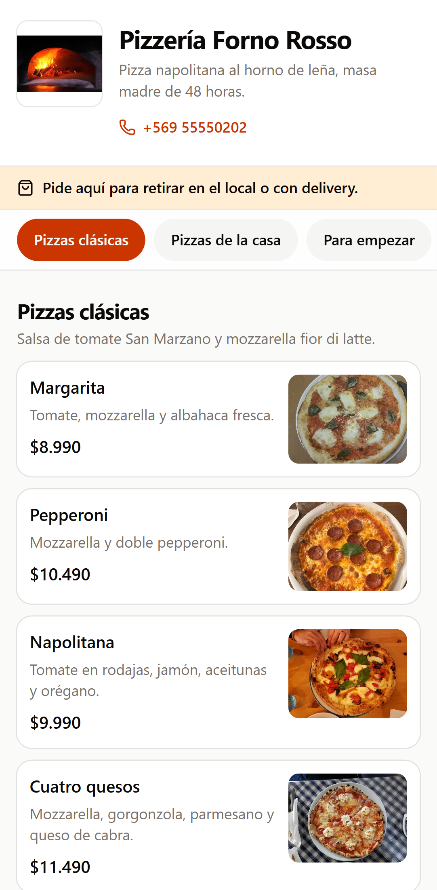 | 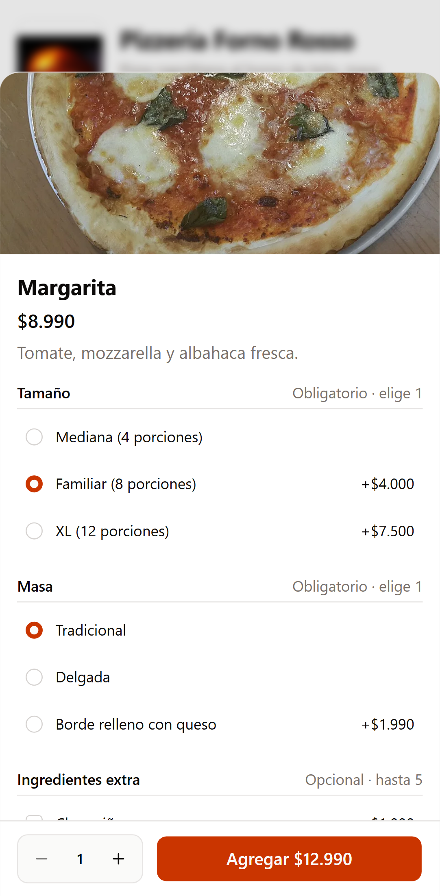 |
| **1.** Abre el menú público. El aviso confirma que el local tiene retiro y delivery. | **2.** Al elegir un producto con opciones obligatorias (tamaño y masa), el botón muestra el precio final. Agrega también una bebida. |

### 2. Cliente: dirección en el mapa y pago

| | |
| --- | --- |
| 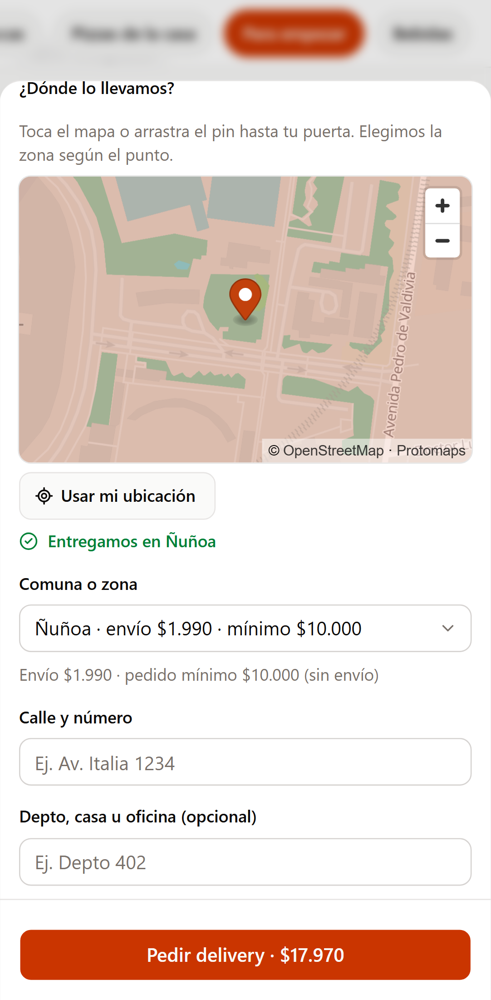 | 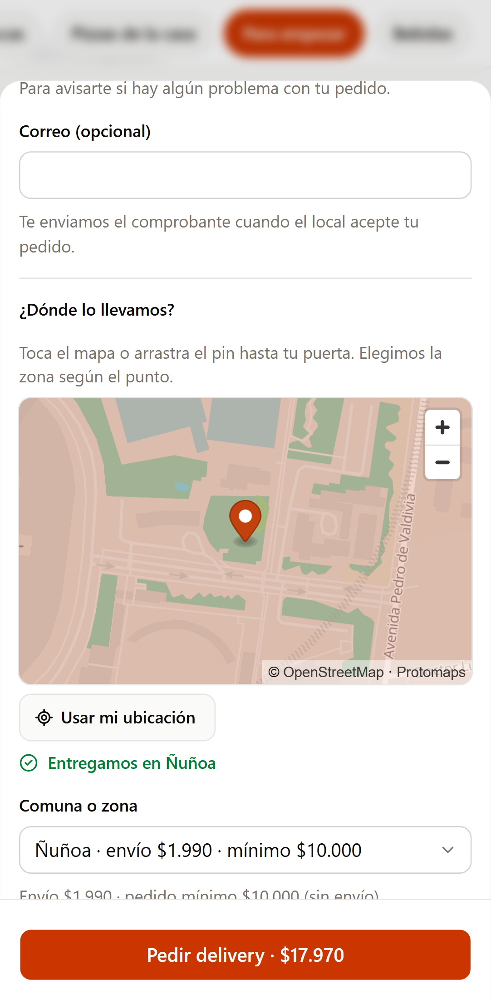 |
| **3.** En «Ver pedido» elige **Delivery** y toca **Usar mi ubicación**. El pin elige la zona solo (Ñuñoa, envío $1.990). Si el pin cae fuera de toda zona, aparece «El local no reparte ahí» y no deja pedir. | **4.** Completa nombre, teléfono y dirección. Con **Efectivo** indica con cuánto pagas: ves tu vuelto. Toca **Pedir delivery**. |

### 3. Pedido creado y aceptado

| | | |
| --- | --- | --- |
| 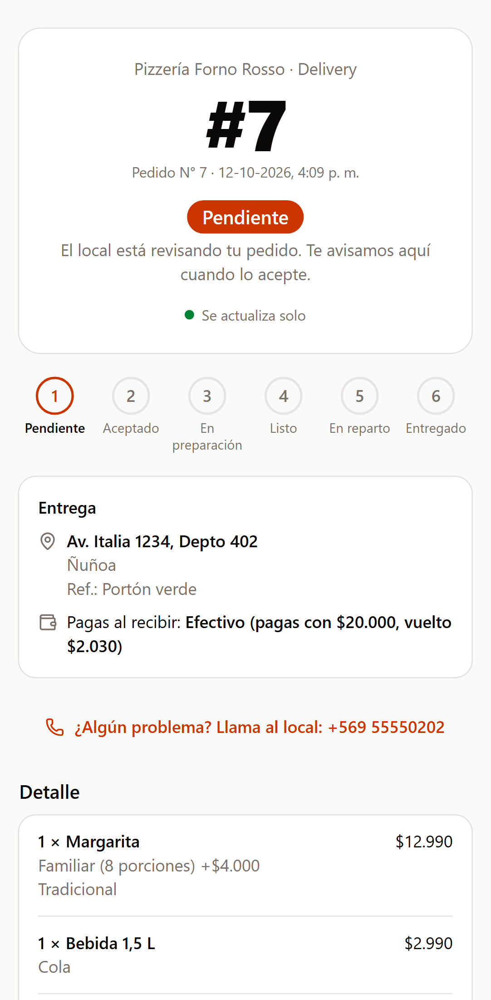 | 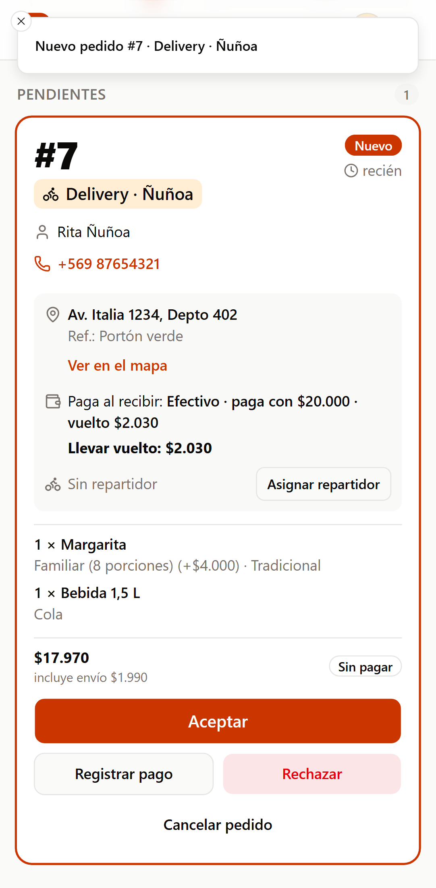 | 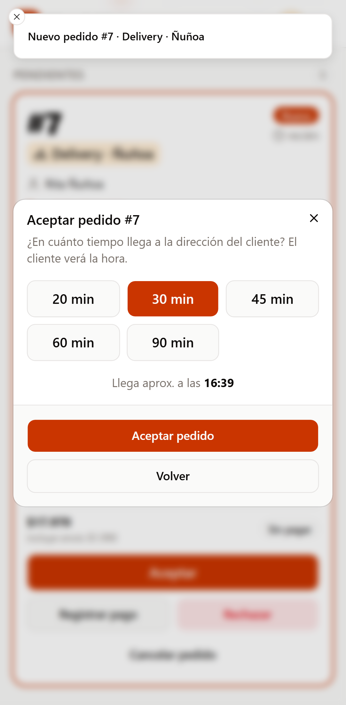 |
| **5. Cliente:** página de seguimiento con el número y «Pendiente». Ese link es la única forma de volver al pedido. | **6. Dueño:** el pedido aparece solo en el tablero, con dirección, zona y «Llevar vuelto». | **7. Dueño:** **Aceptar** pide en cuánto llega; la hora estimada se calcula sola. |

| | |
| --- | --- |
| 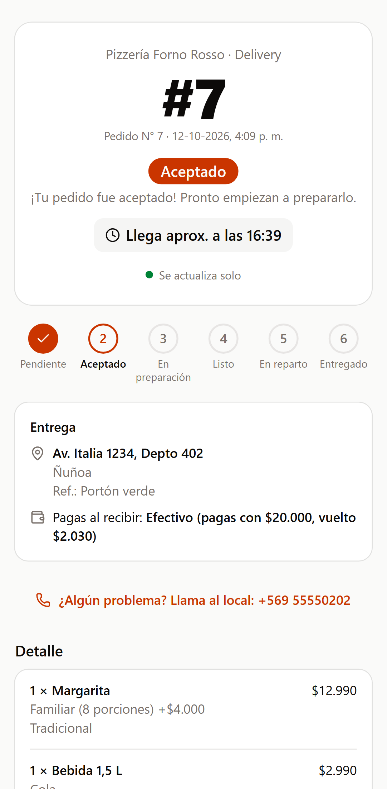 | 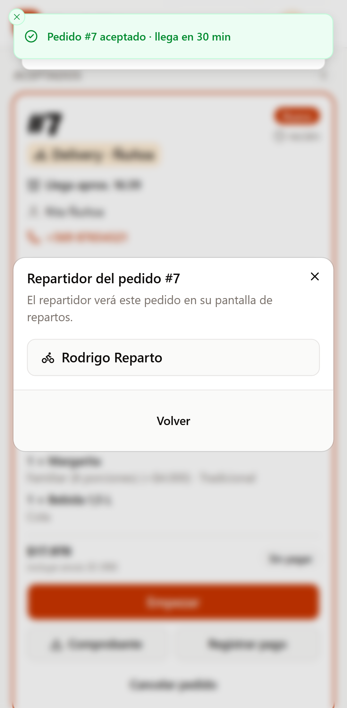 |
| **8. Cliente:** cambia a «Aceptado» con la hora de llegada, sin recargar. | **9. Dueño:** **Asignar repartidor** lista a los miembros con rol Repartidor. Después **Empezar** y **Listo**. |

### 4. Repartidor: sale a repartir

| | | |
| --- | --- | --- |
| 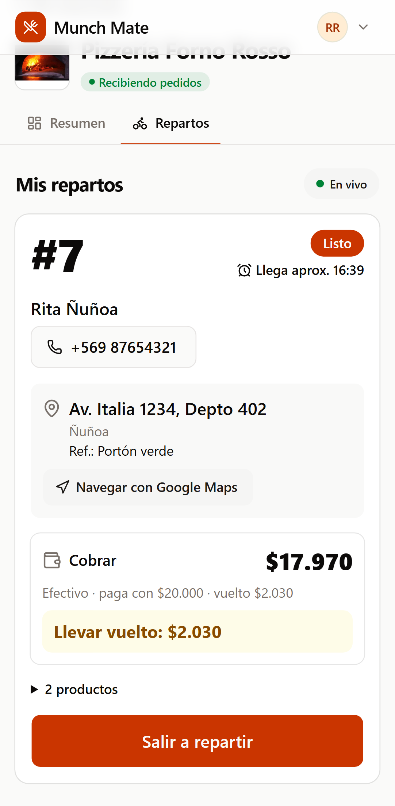 | 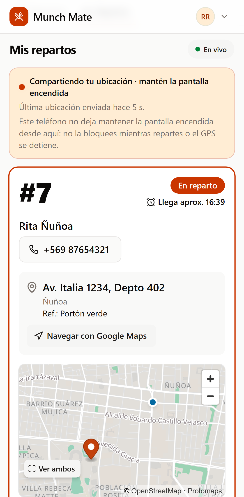 | 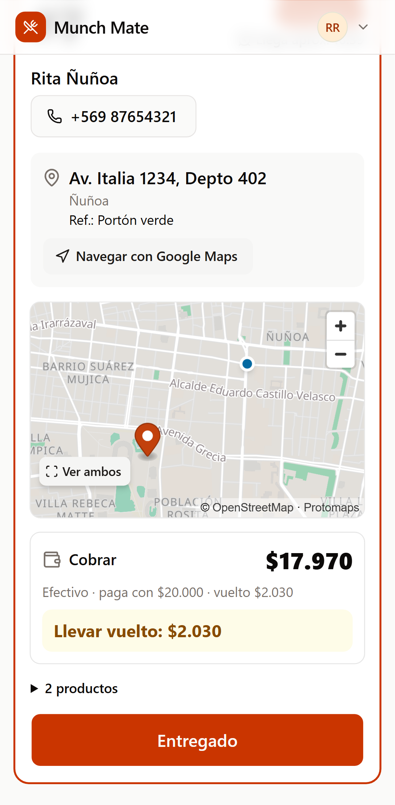 |
| **10.** El repartidor entra directo a **Repartos** y solo ve sus entregas: teléfono, dirección, «Navegar con Google Maps» y el vuelto. | **11.** **Salir a repartir**: el teléfono empieza a compartir su ubicación. Debe mantener la pantalla encendida (con la pantalla bloqueada el GPS se pausa). | **12.** Más abajo, en la misma tarjeta, ve su posición (punto azul) y el destino. |

### 5. Seguimiento en vivo

| | | |
| --- | --- | --- |
| 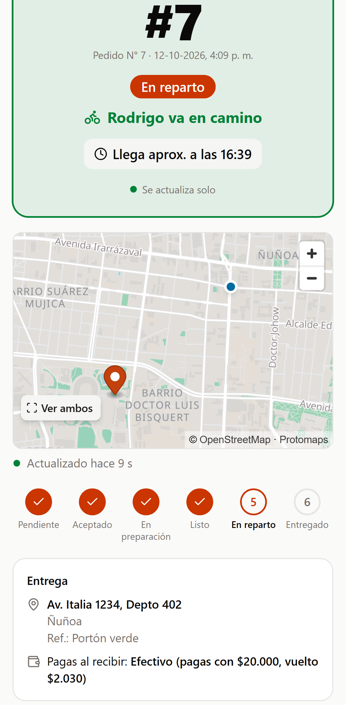 | 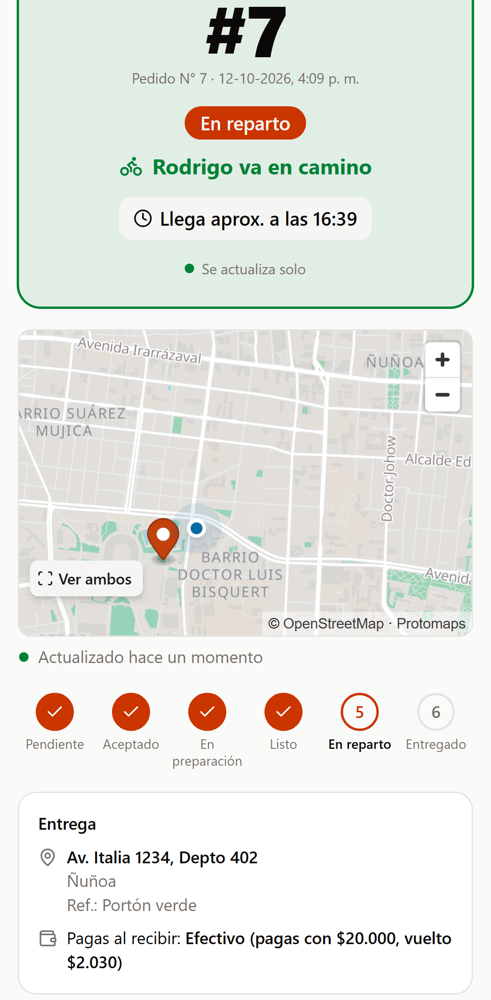 | 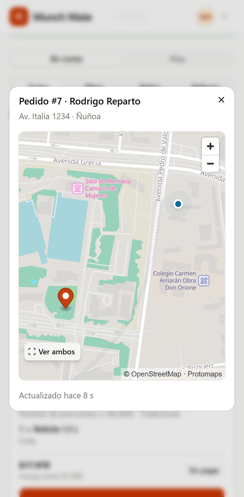 |
| **13. Cliente:** «En reparto», «Rodrigo va en camino» y el mapa con el repartidor saliendo del local. | **14. Cliente:** segundos después el punto azul se movió hacia el pin de su dirección. | **15. Dueño:** en el tablero, **Seguir al repartidor** abre el mismo mapa en vivo. |

### 6. Entrega y cobro

| | | |
| --- | --- | --- |
| 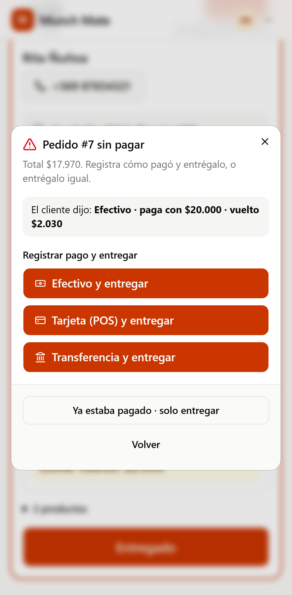 | 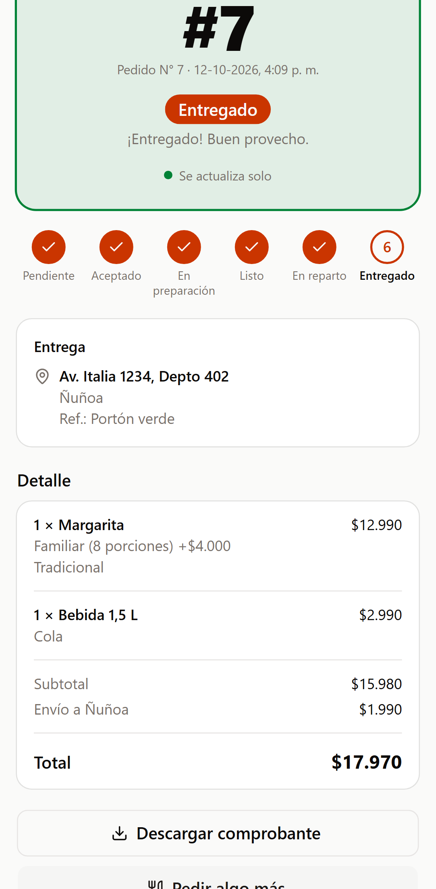 | 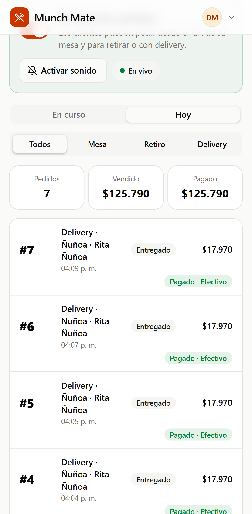 |
| **16. Repartidor:** **Entregado** en un pedido sin pagar pide registrar el cobro (**Efectivo y entregar**). | **17. Cliente:** «Entregado». El mapa desaparece y la última ubicación del repartidor se borra del servidor. | **18. Dueño:** en la pestaña **Hoy** queda «Entregado» y «Pagado · Efectivo». |

## Qué revisar si algo no se ve igual

| Síntoma | Causa probable |
| --- | --- |
| No hay mapa en el checkout, solo la lista de comunas | Falta `pnpm maps:init`, o la zona elegida no está dibujada en el mapa |
| Mapa gris, sin calles | Las teselas aún no cargan (espera unos segundos) o el navegador no tiene WebGL |
| El cliente ve «Esperando la ubicación del repartidor» | El repartidor no dio permiso de ubicación, bloqueó la pantalla o no está en «En reparto» |
| «Asignar repartidor» no muestra a nadie | Nadie tiene el rol Repartidor en **Equipo** |
| El repartidor no ve el pedido | No está asignado a él: cada repartidor ve solo sus entregas |

## Regenerar las capturas

Las capturas las toma un recorrido de Playwright con tres teléfonos simulados (`apps/web/guide/delivery-tracking.guide.ts`). Cuando cambie la interfaz:

```bash
pnpm capturas:delivery   # necesita stack:up, maps:init y seed:demo
```

Reescribe esta carpeta y `capturas.json` (archivo, persona y descripción de cada paso). Deja pedidos reales en la Pizzería de la demo, que se ven en **Ventas**. No forma parte de `pnpm test:web`.
